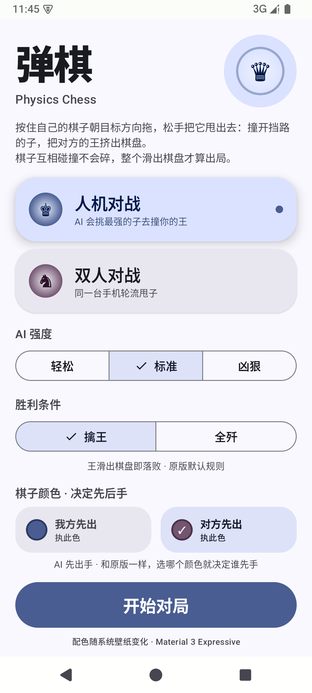
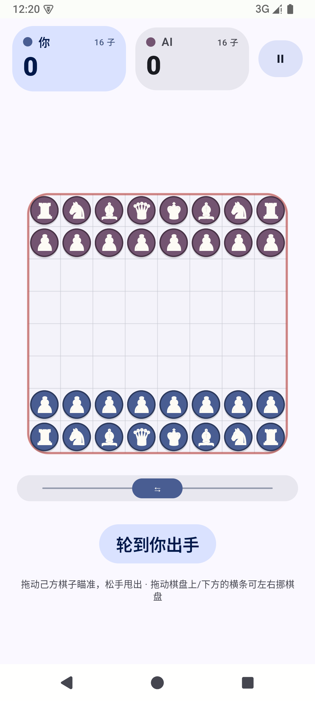
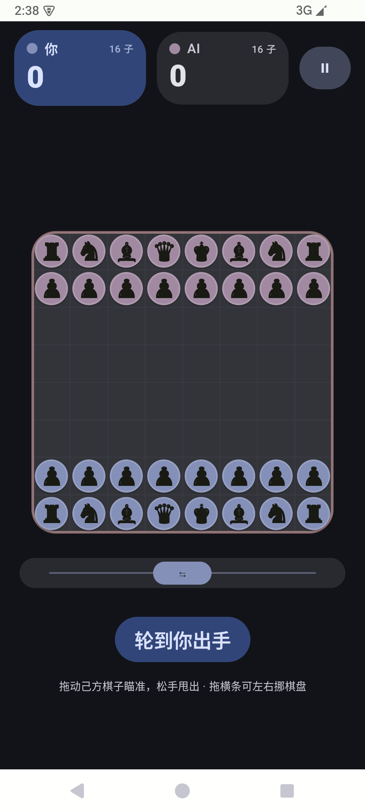

<div align="center">


# Physics Chess


**把棋子甩出去，把对手的王撞出棋盘。**

（中文名：弹棋）· Kotlin + Jetpack Compose + Material 3 Expressive 重写的物理象棋小游戏，
复刻自 Android 老游戏 `CrazyChess v1.3.2`（AndEngine + Box2D）。

</div>

---

## 这是什么

棋盘上摆着国际象棋的 16 枚棋子，但**没有走格规则**。

按住自己的棋子、朝着目标方向拖动，松手就把它整枚甩出去：

- 棋子之间会真实碰撞、传递动量，可以隔山打牛把后面的敌人顶飞；
- 棋子互相撞击**不会**出局，只有**整个滑出棋盘**才碎掉；
- 碎掉的棋子按原版分值给对方加分：兵 5 / 马 25 / 象 20 / 车 30 / 后 50 / 王 100；
- 己方每损失一子，己方的王会变得「更滑」，更容易被推出去（原版的滚雪球机制）。

胜负条件二选一：**擒王**（对方王出局）或**全歼**（吃光对方所有棋子）。

## 截图

| 首页 | 对局（浅色） | 对局（深色） |
| :--: | :--: | :--: |
|  |  |  |

## 特性

- **完整玩法复刻**：质量 / 阻尼 / 分值 / 出局判定 / 计分口径全部对齐原版；甩子速度按原版换算 `速度(格/秒) = 拖拽格数`。
- **局域网对战 + 自动发现**：两台设备连同一个 Wi-Fi，房主点「创建房间」，对面在「自动发现」列表里
  点一下就能进（UDP 广播探测，无需记 IP）；找不到还能退回手填 IP 直连（`47800` 端口，无服务器、无中继）。
  谁出手谁权威 —— 出手方停稳后发一份局面快照给对方覆盖，误差不累积。
- **中英双语**：界面、规则名、引擎状态、联机提示全部双语，首页右上角一键切换（`中 / EN`），
  选择会记住；首次启动跟随系统语言。
- **同一份代码跑两端**：引擎 / 协议 / 发现 / 文案是共享的纯 JVM 源码，
  Windows 桌面版（Kotlin + Swing）和 Android 版可以**跨端联机**。
- **人机 + 双人**：AI 复刻原版启发式（最强子打对面最强子、目标贴边时换最远子、18% 概率换次强子直取对方王），三档难度只调精度与力度。
- **选颜色 = 选先后手**：先手由颜色决定，与坐哪边无关（原版语义）。
- **动态取色**：棋子、棋盘、拖动条、图标全部取自 Material You 配色，跟随壁纸变化；深色模式另有一套明度处理。
- **Material 3 Expressive**：大圆角、弹性动画、分段按钮、终局印章（胜利方配色的「大拇哥」，坐对面的人看到是正的）。
- **响应式**：手机竖屏 / 横屏、平板都做了布局；横屏是「棋盘在左、面板在右」。
- **左右挪棋盘**：靠边的棋子拖不满力，用棋盘上/下那条动态取色的拖动条把棋盘推过去即可；换手自动回中。

## 局域网对战怎么用

1. 两台设备（手机 / 平板 / Windows 电脑都行）连**同一个 Wi-Fi**。
2. 两边都可以先填个昵称（最多 10 字），对局里计分卡就显示这个名字。
3. 房主：首页选「局域网对战」→「创建房间」，等对面进来。
4. 客人：同样选「局域网对战」，稍等一两秒，「自动发现」里就会列出房主的房间，点一下即加入。
   - 列表里没有？点「刷新」再等两秒；还是没有就展开「以 IP 直连」，把房主界面上显示的地址填进去。
5. 连上即自动开局：**房主执下方、客人执上方**，先后手和胜利条件由房主带过去。

自动发现走 UDP：客人向广播地址的 `47801` 发 probe（带自己的应答端口），房主单播回一条 offer。
客人用的是**临时端口**而不是固定端口，所以同一台机器上开两个实例也不会互抢。

客人的界面是**镜像**的：自己的棋子在屏幕下方、对手在上方，不用把手机倒过来看。
镜像只翻坐标不翻画布，棋子字形始终正立。双方昵称通过 `hello` 交换，对局中一直显示。

协议是一行一条 JSON（`hello` / `shot` / `state` / `resign` / `rematch` / `bye`），
物理不锁步：出手方在棋子停稳后广播权威局面，对端直接覆盖本地方案，
所以两边即使算力不同也不会越走越偏。对手掉线会显示「对手已离开」，暂停里可以认输。

- **客人不用倒着拿手机**：客人执上方，棋盘会按客人视角镜像（自己的子永远在下半屏），棋子字形仍正立。
- **昵称**：建房 / 加入前可以填昵称（最多 10 字），对局里计分卡直接显示双方昵称。
- **可以中途放弃**：等待对手加入、正在连接时都有取消按钮；进了对局也能在暂停里认输。

## 技术要点

| | |
| --- | --- |
| 语言 / UI | Kotlin 2.0、Jetpack Compose、Material 3 |
| 物理 | 自写圆形刚体（固定子步积分 + 冲量解算 + 恢复系数 0.5），无 Box2D 依赖 |
| 架构 | `GameEngine` 纯 Kotlin 无 Android 依赖，UI 每帧取快照驱动重组 |
| 音效 | `SoundPool`（出手 / 决胜 / 欢呼，素材取自原版 `assets/mfx`） |
| 图标 | 自适应图标（渐变底 + 光环王冠 + Android 13 单色层） |
| 桌面版 | Kotlin + Swing（JDK 17 自带），共享同一份引擎 / 协议 / 发现 / i18n 源码 |
| 自动发现 | UDP 广播 probe → 单播 offer，`LanDiscovery.kt` 纯 `java.net`，两端共用 |
| i18n | 中文原文当 key 查字典（查不到原样返回），Compose 侧用同签名 `Text` 包装器接管全部文案 |

## 构建

需要 JDK 17 与 Android SDK（compileSdk 35）。

```bash
# debug
./gradlew :app:assembleDebug

# release（可选：设置自己的签名材料；不设置则沿用 Gradle 默认行为）
export CRAZYCHESS_KEYSTORE=/absolute/path/to/your.keystore
export CRAZYCHESS_KEYSTORE_PASSWORD=yourpass      # 默认 crazychess
export CRAZYCHESS_KEY_ALIAS=youralias             # 默认 crazychess
./gradlew :app:assembleRelease
```

> 签名材料不进仓库：`app/build.gradle.kts` 从上面这三个环境变量读取，
> debug 与 release 会共用同一把证书，方便 `adb install -r` 在两种构建间来回覆盖。

安装到设备：

```bash
adb install -r app/build/outputs/apk/debug/app-debug.apk
adb shell am start -n dev.whale.crazychess/.MainActivity
```

如果 Gradle 提示 `Could not connect to Kotlin compile daemon`，在 `gradle.properties` 里加：

```properties
kotlin.compiler.execution.strategy=in-process
```

## Windows 桌面版

`desktop/` 下是一个 Swing 实现，复用了 `GameEngine`、`LanSession`、`LanDiscovery`、`Json`、`I18n`
这五个纯 JVM 文件，所以规则、联机协议、自动发现、文案与手机端完全一致，可以跨端对战。

```bash
bash desktop/build.sh     # 离线编译（不需要外网，用 Gradle 缓存里的 kotlin-compiler-embeddable）
bash desktop/package.sh   # 打包：jlink 精简 JRE + jar + 启动脚本 → desktop/dist/PhysicsChess
```

产物 `desktop/dist/PhysicsChess/PhysicsChess.bat`，双击即可运行；整个目录拷到别的 Windows 机器上
也能直接跑（自带运行时，不用装 Java）。发布包是 `desktop/dist/PhysicsChess-1.4-win.zip`。

> 操作与手机一致：按住自己的子朝目标方向拖、松手甩出；`Esc` / 暂停按钮可以认输或退出对局。

## 版本记录

| 版本 | 内容 |
| --- | --- |
| 1.0 | 首个公开版本：物理棋盘、人机三档、同屏双人、动态取色与动态图标 |
| 1.1 | 局域网对战（TCP 47800，谁出手谁权威），暂停里可认输 |
| 1.2 | 联机昵称（10 字上限）、客人视角棋盘镜像、沉浸式状态栏 |
| 1.3 | 结算大拇哥朝向胜利方；创建/加入房间可取消 |
| 1.4 | 局域网 UDP 广播自动发现；中英双语切换；新增 Windows 桌面版（跨端联机） |

1.1–1.2 只做过内部构建，1.3 是 1.0 之后第一个正式发布版。

## 自动发布

推一个 `v*` 标签（或在 Actions 页手动触发）会走 `.github/workflows/release.yml`：
构建 release APK → 校验签名 → 上传构建产物 → 挂到对应的 GitHub Release。

签名材料放在仓库 Secrets 里，不随代码分发：

| Secret | 说明 |
| --- | --- |
| `ANDROID_KEYSTORE_BASE64` | keystore 文件的 base64（`[Convert]::ToBase64String([IO.File]::ReadAllBytes("x.keystore"))`） |
| `ANDROID_KEYSTORE_PASSWORD` | keystore 口令 |
| `ANDROID_KEY_ALIAS` | 密钥别名 |
| `ANDROID_KEY_PASSWORD` | 密钥口令 |

没配 `ANDROID_KEYSTORE_BASE64` 时流程仍会构建，但只上传未签名 APK 到 Actions 产物，不会发布 Release。

## 目录

```
app/src/main/java/dev/whale/crazychess/
├── MainActivity.kt          # 首页 ↔ 对局 的状态导航与转场
├── SoundFx.kt               # SoundPool 封装
├── game/GameEngine.kt       # 规则 + 物理 + AI（纯 Kotlin）
└── ui/
    ├── Theme.kt             # M3E 形状/字体、动态取色、棋盘配色映射
    ├── HomeScreen.kt        # 模式 / 难度 / 胜负条件 / 颜色（先后手）
    ├── GameScreen.kt        # 对局页、主循环、计分、战果、弹窗、横竖屏、拖动条
    └── BoardView.kt         # Canvas 棋盘、拖拽甩子、瞄准线、坠落特效
```

开发过程与踩坑记录见 [PROGRESS.md](PROGRESS.md)。

## 致谢

- 玩法与数值来自 **CrazyChess v1.3.2**（原作者 Expedition107），本项目是对其规则的重写实现，未使用其贴图资源（音效除外，仅作个人学习用途）。
- 界面参考 **Material 3 Expressive** 设计语言。

## License

[MIT](LICENSE)
